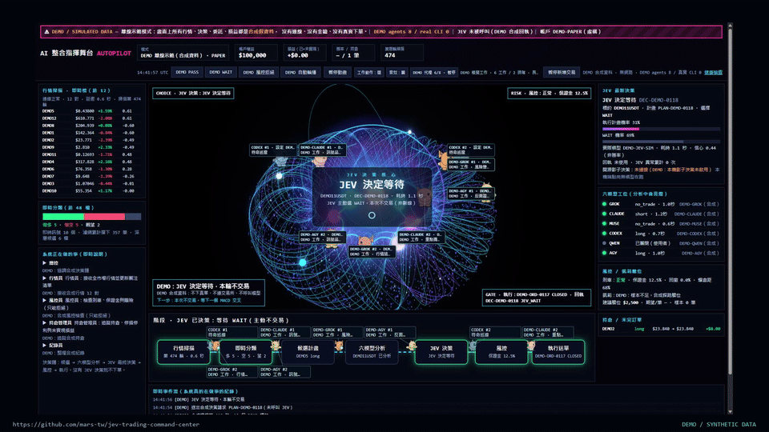

# JEV Trading Command Center

A paper-trading research application with TypeSafe Jev decisions, an animated 3D command center, model pets, and a local offline demo. The application is open source; the Jev model and external provider services are not included.

這是 **JEV 整合程式的開源版**：保留環狀 3D 首頁、沿線移動的多視角寵物、模型／任務標籤與決策流程。所有交易由程式內的 PaperBroker 模擬，沒有交易所私有下單功能。



[觀看 70 秒展示影片與下載](https://github.com/mars-tw/jev-trading-command-center/releases/tag/v0.1.0) · [程式展示 MP4](https://github.com/mars-tw/jev-trading-command-center/releases/download/v0.1.0/jev-showcase.mp4)

## 先開啟離線展示

需要 Python 3.11 或更新版本，以及支援 WebGL 的瀏覽器。DEMO 不需要安裝 Python 套件、API 金鑰、原生 AI CLI 或連網；Three.js 已隨程式附上。

```sh
python -B run_app.py --demo --port 8775
```

Windows 也可使用 `py -3 -B run_app.py --demo --port 8775`。接著開啟 <http://127.0.0.1:8775/stage.html>，按 `Ctrl+C` 結束服務。

沒有參數時預設也是離線 DEMO。可以先執行不開服務的自我檢查：

```sh
python -B run_app.py --demo --check
```

**DEMO 畫面上的行情、帳戶、損益、JEV 回覆與代理工作全部是合成資料。** `DEMO PASS`、`DEMO WAIT`、`DEMO 風控拒絕` 和 `DEMO 自動輪播` 只切換示範情境，不呼叫模型、不啟動原生 CLI，也不送出真實委託。錄影使用的就是這個模式。

## 介面

- 原有 3D 核心、行情清單、決策回執、風控、模擬持倉及事件流。
- 每隻寵物有模型／實例名稱與目前工作；工作、待命、冷卻、離線分開呈現。
- 正面、左右側面與背面，四幀走路步態及工作道具。角色沿原路線移動，支援暫停與恢復。
- 只有執行回執才呈現通過；WAIT、風控拒絕及缺少決策分開顯示。模型 confidence 不是勝率。
- 桌面顯示角色旁的任務卡；窄螢幕保留核心，下方另列可讀的任務標籤。

此版的主要入口是 `stage.html`。

## 使用公開行情與 Jev 做紙上研究

這個模式會對外連線，並可能使用你自行提供之 API／CLI 的額度。先安裝正式模式依賴：

```sh
python -m venv .venv
# Windows: .venv\Scripts\python.exe -m pip install -r requirements.txt
# macOS/Linux: .venv/bin/python -m pip install -r requirements.txt
```

在啟動程序的環境中提供 `TYPESAFE_API_KEY`，再執行：

```sh
python -B run_app.py --real-paper --port 8765
```

請使用上一步虛擬環境內的 Python。金鑰缺少時會拒絕啟動此模式；不會改讀 `JEV.txt` 或從其他專案取得金鑰。不要把真實金鑰寫入程式、設定、Git 或命令歷史。

Bash 可用不回顯的互動輸入：

```sh
read -r -s -p 'TypeSafe API key: ' TYPESAFE_API_KEY; echo
export TYPESAFE_API_KEY
python -B run_app.py --real-paper --port 8765
unset TYPESAFE_API_KEY
```

PowerShell 可透過你既有的 OS／秘密管理工具把金鑰注入目前程序的環境。`.env.example` 只列變數名稱，本程式不自動載入 `.env`。

可將 `config.example.json` 複製為被 Git 忽略的 `config.json` 調整非秘密設定。預設關閉外部分析 CLI 與本機模型整合；這些服務的安裝、授權與使用額度由使用者自行管理。

### 選用的原生 CLI 伴跑

這是獨立的公開行情研究台帳，不把伴跑結果直接當作 JEV 或模擬交易授權。必須明確選擇啟用；請先自行安裝並登入需要的 CLI。

```sh
python -B run_workguild.py --enable-native-cli --source-url http://127.0.0.1:8765 --port 8766 --capacity 8
```

Windows PowerShell 入口：

```powershell
./run_workguild.ps1 -EnableNativeCli -Port 8766 -Capacity 8
```

要讓紙上研究頁面連接這個已另外啟動的伴跑服務：

```sh
python -B run_app.py --real-paper --port 8765 --native-companion
```

`--native-companion` 不會替你啟動 CLI、登入帳戶或更改認證設定。關閉頁面不等於停止另外啟動的後端程序，請在對應終端以 `Ctrl+C` 結束。

## 測試

```sh
python -B -m unittest discover -s tests -v
node tests/test_line_workers.cjs
```

Node.js 僅用於前端驗證，不是離線展示的執行依賴。真實 API 回覆與各平台原生 CLI 的相容性仍取決於外部服務；離線測試不會冒充實際模型驗收。

## 程式結構

`run_app.py`／`run_demo.py` 是入口；`scanner/demo_engine.py` 與 `demo_server.py` 提供合成示範；`engine.py`、`jev_client.py`、`jev_decision.py`、`paper_broker.py` 是公開行情／Jev／紙上研究流程；`agent_cli.py` 與 `agent_guild.py` 提供選用的原生 CLI 伴跑。`web/` 保留原環面首頁與寵物顯示層，`web/vendor/three/` 是附帶的授權依賴。

## 授權與資料

應用程式及原創程序化寵物美術採 [MIT License](LICENSE)。Three.js 等第三方元件保留各自授權，見 [THIRD_PARTY_NOTICES.md](THIRD_PARTY_NOTICES.md)。展示配樂 **Neon Circuit** 為原創程序化合成作品，來源、音樂授權與成品隨版本發布。

本專案沒有附帶私人帳戶資料、交易紀錄、供應商認證、模型權重或原生 CLI 執行檔。Jev 仍透過 [TypeSafe 官方 API](https://docs.typesafe.ai/api) 使用；這不是 TypeSafe 官方產品，也不以示範結果主張投資績效。安全預設及回報方式見 [SECURITY.md](SECURITY.md)。
